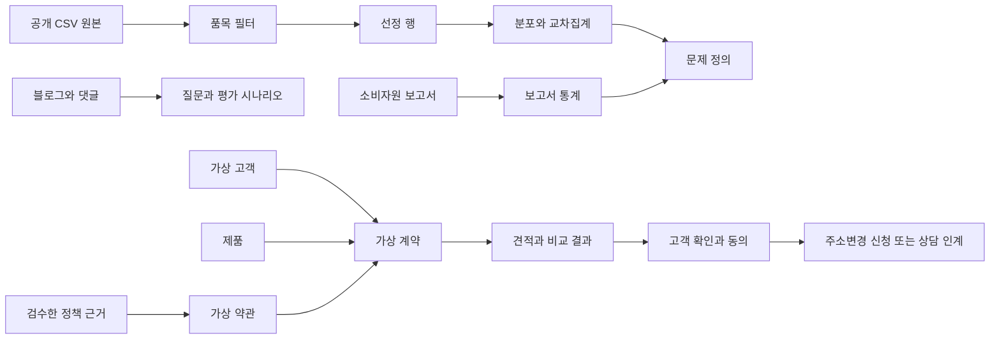

# LG Move Care 데이터 관계와 공기청정기 적용 가이드

`DataResearch/khh`의 기존 자료는 워시타워 이전설치 데모용이다. 이번 공기청정기 기획에는 출처 관리, 계약 조회 구조, 비용 항목 분리, 동의·중복 방지 설계를 재사용할 수 있다. 제품별 요금·관리지역·업무 상태는 공기청정기 기준으로 별도 구성해야 한다.

검토 기준은 2026-10-12, 기존 커밋 `8b90f6bd12ee396dfa8ca238da13a5fa64df9db0`이다. 원본·가공본·Mock DB의 내부 일관성 검사 19개는 통과했다. 이는 실제 LG 계약 적용, 운영 가능성, Agent 평가 통과를 의미하지 않는다. 검사 항목과 결과는 [검증 기록](lg_move_care_data_audit.json)에 있다.

## 데이터별 역할

| 자료 | 실제로 들어 있는 것 | 프로젝트에서 쓸 곳 | 연결 방식과 한계 |
| --- | --- | --- | --- |
| `raw/kca_relief_20260630.csv` | 2026년 2분기 피해구제 12,834행, 8개 컬럼 | 품목별 불편 탐색, 배경 분석 | 행 단위 공개 자료. LG 브랜드·이사·고객 계약 ID가 없어 Mock 계약과 고객 단위 JOIN 불가 |
| `processed/product_filter.json` | 기존 10개 품목명과 분류 매핑 | 가공 대상 정의 | 정확한 품목명 일치. 기존 필터에는 공기청정기 없음 |
| `processed/kca_selected_appliances.jsonl` | 위 필터로 고른 291행 | 기존 워시타워 등 가전 분석 | `source_id=KCA_CSV` 및 `source_row`로 원본 추적 |
| `processed/kca_public_profile.json`, `kca_product_reason_age.json` | 291행의 분포·교차집계 | 차트·발표 | 같은 원본의 가공 결과이므로 291행과 합산 금지 |
| `raw/kca_subscription_report_202604.pdf`, `processed/kca_report_statistics.json` | 보고서와 전사한 통계 46개 | 계약·비용 정보 문제의 배경 근거 | 피해구제 2,624건과 별도 설문 500명을 구분. `source_id`, 표 구분, 기간, 분모, PDF 쪽수로 추적 |
| `processed/rag_rules.jsonl` | 워시타워 공개 안내 요약 9개 | 기존 RAG 구조 참고 | `rule_id → source_id → sources.json`. 실제 서명 계약이 아니며 시행일 9개 모두 미확인 |
| `processed/installation_reference.json` | 워시타워 설치공간 참고값 | 기존 워시타워 시나리오 | 공기청정기 방문관리 판정에 사용하지 않음 |
| `mock/customers.json`, `contracts.json`, `products.json`, `terms.json` | 고객 100명·계약 100건·워시타워 제품군 1개·가상 약관 1개 | 계약 조회와 계산 Tool의 구조 | 고객·계약·제품·약관의 키로 연결. 실제 LG 고객 데이터 아님 |
| `mock/quotes.json`, `slots.json`, `bookings.json` | 이전 견적 100건, 일정 후보 84개, 초기 예약 0건 | 기존 이전설치 데모 | 주소변경 신청·방문관리 가능 여부와는 다른 업무 데이터 |
| `mock/lg_move_care.sqlite` | 위 JSON의 동일한 초기 업무 데이터 | FastMCP 조회 및 데모 저장소 | 이번 검사에서 payload 일치. 실행 후 JSON과 자동 동기화되지 않으므로 실행 중 기준 저장소는 하나로 정함 |
| `mock/evaluation_cases.json` | 정상 15개, 부족정보·예외·위험 각 5개 | 테스트 입력과 기대값 | 총 30개 모두 `not_run`. 정상 기대값 15개 산술 일치와 Agent 성공률은 다른 의미 |
| `docs/mcp/` | 도구 계약·연동·예약 설계·출처 14개 | 구현 담당자 참고 | 실행 서버가 아니라 설계·예시. 이번 공기청정기 Tool 명세와 명칭·입출력을 조정 |
| [추가 출처 목록](lg_move_care_sources.json) | 공식 자료·블로그·영상·댓글·API·기술 문서 29개 | 문서 선별과 출처 관리 | 원문 데이터셋 전체가 아니라 출처 목록. `verification`과 적용 범위를 보고 채택 |
| [공기청정기 Tool 설계](lg_move_care_fastmcp_blueprint.json) | Tool 8개와 평가 방향 14개 | 새 MVP 설계 | 실행 코드·실제 고객 데이터 아님 |

## 실제 데이터 관계

공개 소비자 데이터와 Mock 고객 데이터는 사람을 기준으로 연결하지 않는다. 공개 자료는 문제와 질문을 정하는 데 쓰고, 고객별 처리는 업무 데이터와 검수한 규칙으로 수행한다.

아래 키는 기존 저장소에 실제로 존재한다.

| 자식 필드 | 연결 대상 | 의미 |
| --- | --- | --- |
| `contracts.customer_id` | `customers.customer_id` | 계약 주체 |
| `contracts.product_id` | `products.product_id` | 계약 제품 |
| `contracts.contract_version` | `terms.contract_version` | 적용한다고 가정한 Mock 약관 버전 |
| `terms.source_rule_ids[]` | `rag_rules.rule_id` | 계산 규칙의 공개 참고 근거 |
| `rag_rules.source_id` | 루트 `sources.json`의 `source_id` | 원문 출처 |
| `quotes.contract_id` | `contracts.contract_id` | 어떤 계약의 이전 견적인지 |
| SQLite `bookings.contract_id`, `bookings.slot_id` | 계약·슬롯 | 기존 예약용 관계. 현재 실제 행은 없음 |
| 선정 행의 `source_id`, `source_row` | 출처 목록·원본 CSV | 수집 파일 안의 원본 행. 첫 데이터 행은 2 |

예를 들어 `C001 → CT001 → MOCK-WASHTOWER-01 / MOCK-20261012-V1 → Q001`은 하나의 가상 고객 시나리오다. 이 관계는 재사용할 수 있지만, C001을 공개 피해구제 CSV의 어떤 사람과도 연결할 수 없다. 현재 고객당 계약 한 건은 시드 구성일 뿐, 실제 서비스에서는 복수 계약 선택을 지원해야 한다.

원본 `source_row`는 공식 사건 ID가 아니다. 재다운로드 시 행 순서가 바뀔 수 있으므로 `source_id + source_file_hash + source_row`로 계보를 보존한다. 동일 속성의 공개 행을 같은 사건이라고 보고 삭제하지 않는다.

## 공기청정기 자료를 적용할 때 달라지는 부분

| 항목 | 기존 저장소 | 공기청정기 MVP에서 할 일 |
| --- | --- | --- |
| 제품 | 워시타워 제품군 1개 | 별도 공기청정기 제품·계약 시드 생성. 기존 계약의 제품명만 바꾸지 않음 |
| 비용 | 회수비 111,000원을 가정 적용한 워시타워 계약 | 품목·가입시점·계약 버전별 규칙 선택. 추가 자료의 공기청정기 회수비 예시와 혼용 금지 |
| 이사 처리 | 철거·운송·재설치 견적과 기사 예약 | 방문관리 가능 여부·주소 변경 신청·상담 인계 |
| 주소 | 가상 문자열과 지역 | `address_ref`로 검증된 주소를 참조. 주소 API의 유효 주소 결과는 LG 서비스 가능 판정이 아님 |
| 관리지역 | 별도 데이터 없음 | `service_coverage` Mock을 만들어 가능·불가·미확인을 구분. 실제 지역 전체를 임의로 불가 처리하지 않음 |
| 관리 방식 | 필드 없음 | `care_mode`, 관리주기, 방문관리 지원 여부 추가 |
| 구독료 | 기본요금·현재 납부요금만 있음 | 할인 종료 등을 반영할 `billing_schedule` 추가 |
| 기간 | 모든 계약에서 의무기간과 총기간이 같음 | 의무기간은 끝났지만 계약은 남은 사례 추가 |
| 실행 기록 | 초기 이전설치 예약 테이블 | 주소변경 초안·동의·신청·상담 인계 기록을 별도 설계 |

추가로 필요한 연결 키는 **제안**이며 아직 저장소의 업무 데이터에 없다. `coverage`는 주소/지역 참조·제품·관리방식·적용기간으로 조회하고, 견적은 `contract_id + address_ref + 기준일 + 규칙 버전`을 보존한다. 신청은 `draft_id + consent_id + idempotency_key`로 연결하며, 동의는 사용자가 본 주소·날짜·견적 내용에 결합한다. 상담 인계에는 별도의 동의를 사용한다.

## 정합성 검사에서 확인한 것과 남은 문제

- **원본과 가공본:** 배포된 원본 5개 파일의 크기·SHA-256이 manifest와 일치한다. 공개 CSV 12,834행에서 기존 291행 추출 및 분포·교차집계를 재계산했으며 일치한다. LG HTML 3개가 없는 것은 `local_only`로 명시된 배포 범위다. 현재 파일을 재검증했다는 뜻으로 기존 해시를 사용하면 안 된다.
- **업무 데이터:** 기본 키 중복과 외래 키 누락이 없고, SQLite 무결성 검사와 JSON payload 비교를 통과했다. 전체 기간·날짜 및 견적 숫자도 시드 규칙 안에서 일치한다.
- **일정:** 같은 기사·같은 시각에 두 후보가 있는 조합이 42개다. 실제 중복 예약이 발생한 것은 아니지만, 84개 슬롯을 독립적인 정원으로 예약하게 만들면 충돌한다. 기존 문서에도 기재된 제약이다. MVP가 주소변경 접수까지만 한다면 이 예약 구조는 필수 범위가 아니다.
- **정책:** RAG 9개 모두 시행일 미확인이고 고객 서명 약관이 아니다. 형식·출처 연결이 정상이어도 실제 계약 적용이 확인된 것은 아니다. 계산식은 검수된 버전의 Python 규칙으로 관리하고, RAG는 근거를 설명한다.
- **검증 범위:** 정상 기대값 15개는 산술상 일치하지만, Agent를 실행한 15회 성공이 아니다. 평가 30개는 모두 미실행이며 새 기획의 평가 14개도 시나리오 목록이다.
- **기획안 통계:** 1372 상담 1,847,674건, 공기청정기 렌탈 1,423건의 원본은 이 브랜치에 없다. `552/1423=38.79%`와 이를 11.78%와 비교한 3.29배의 산술만 확인했다. 기간·품목 코드·결측 처리·분모·추출 파일을 확보해야 재현할 수 있다.

## 새로 추출한 공기청정기 피해구제 표본

기존 공개 CSV에서 실제 관측한 두 품목명을 골라 [공기청정기 관련 21행](lg_move_care_air_purifier_relief_2026q2.jsonl)을 추가했다. 원본 컬럼과 `source_row`, 원본 파일 해시를 보존했다.

| 원본 품목명 | 건수 | 계약해제·해지/위약금 건수 |
| --- | ---: | ---: |
| 공기청정기대여(렌트) | 12 | 8 |
| 공기청정기 | 9 | 0 |

이는 **2026년 2분기 피해구제 접수의 작은 표본**이다. `공기청정기` 분류만으로 거래형태를 모두 구매라고 확정하지 않는다. LG 고객·이사 원인을 식별하지 못하며, 1372 상담 비율 38.79%나 렌탈/구매 3.29배를 재현하지 않는다. 이 표본은 별도 탐색 결과 또는 품목 필터 예시로 사용한다. 0건이 있는 비교에서 비율 배수를 만들지 않는다.

## 출처 사이의 중복과 문항 의미

루트 `sources.json`, `docs/mcp/sources.json`, 추가 `lg_move_care_sources.json`은 서로 다른 목록이다. 루트의 `source_id`와 추가 목록의 `id`는 이름만 보고 연결하지 말고, 별도 매핑 또는 출처 URI를 둔다.

| 관계 | 처리 |
| --- | --- |
| 추가 `KCA02` ↔ 기존 `KCA_REPORT` | URL이 같은 보고서. 기존 저장소에는 PDF와 통계가 있으므로 이를 활용 |
| 추가 `KCA01`·`KCA03`·`YT02`와 위 보고서 | 같은 조사에 대한 보도자료·첨부·보도. 독립된 조사 여러 개로 세지 않음 |
| 추가 `D01` ↔ 기존 `KCA_CSV` | 1372 상담과 피해구제. 다른 데이터이며 서로의 대체 원본이 아님 |
| 추가 `FM01` 등 ↔ 기존 `docs/mcp/sources.json` | 같은 기술 문서는 URL·버전으로 중복 정리. 도구 수나 출처 개수를 효과 근거로 사용하지 않음 |
| `C01`~`C05` → `YT01` | 단일 영상의 편의표본 댓글 5개. 질문 표현과 관리 편익 항목 설계에 사용 |

500명 설문의 31.4%는 **중도해지 위약금이 없다고 인식한 응답**이다. 단순히 정확한 금액을 모르는 응답 전체라는 뜻이 아니다. 추가 출처 목록의 문구도 이 의미로 수정했다. 보고서의 계약해지·위약금 950건은 계약 관련 1,446건 중 65.7%이고, 전체 2,624건 중에서는 약 36.2%다. 분모를 함께 표시한다.

## FastMCP에서 사용하는 순서

1. **인증과 계약 선택:** FastAPI가 사용자의 조회 권한을 확인한다. FastMCP의 `get_contract`가 공기청정기용 계약 시드를 반환한다. 기존 `get_customer_contract` 설계의 키·권한 처리 구조를 활용한다.
2. **주소와 관리 조건:** 주소를 정규화하고 복수 후보이면 고객이 선택한다. `check_service_coverage`가 계약 제품·관리방식·주소·이사일에 맞는 Mock 결과를 반환한다. 공개 통계나 기사 슬롯으로 관리 가능 여부를 추정하지 않는다.
3. **계산과 근거:** `search_policy`는 제품·계약 버전·시행일이 맞는 검수 문서를 검색한다. `quote_options`는 도메인 계산 함수를 호출해 동일한 비교 기간의 향후 납부액과 해지 항목을 계산한다. 기존 `calculate_termination_cost`의 항목 분리 구조를 활용하되 워시타워 숫자를 가져오지 않는다.
4. **비교 카드:** 유지 비용·해지 비용·필터/방문관리/A/S 차이·미확인 조건·출처·Mock 표시를 함께 보여준다. 기존 C001의 243,400원은 일회성 비용 차이일 뿐 총절감액이 아니다. 새 공기청정기 예시의 290,160원도 미확인 비용을 제외한 가상 소계다.
5. **동의 후 기록:** 유지하면 `prepare_address_change → submit_address_change`, 해지 희망이나 확인 필요 시 `create_counseling_handoff`를 사용한다. 주소나 견적이 바뀌면 다시 확인한다. 접수 상태 `REQUESTED`를 변경 완료·해지 완료로 표시하지 않는다.
6. **평가:** 원본 추적, 제품 혼동 차단, 0원/미확인 구분, 기간 경계, 동의 누락, 변경 후 동의 재사용, 중복 접수, 조회 실패를 검사한다. 출처 문구·댓글을 Tool 실행 명령으로 취급하지 않는다.

먼저 공기청정기 계약·관리지역·정책·주소변경 기록으로 정상 시나리오 하나와 서비스 미확인 시나리오 하나를 연결하면 된다. 통계 전체를 벡터 DB에 넣거나 고객 대화마다 댓글을 수집할 필요는 없다. 고객 계약은 구조화 조회, 계산은 Python, 검수 정책 설명은 RAG, 상태·동의는 FastAPI가 담당한다.
