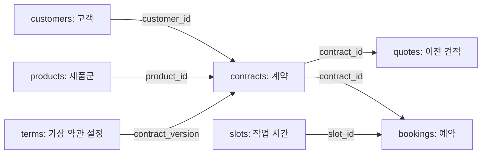

# 고객 계약·이전 견적·기사 일정·예약 정보 설명

확인일: **2026-10-12**. 첨부한 MCP 도구 표를 기준으로 저장소의 실제 파일과 SQLite 구조를 확인한 설명이다.

**이 네 가지 업무 데이터는 실제 LG 내부에서 수집한 자료가 아니라, MCP 개발과 시연을 위해 만든 합성 데이터(Mock)다.** 공식 홈페이지·소비자원에서 수집한 자료는 규정 참고와 기획 근거로 따로 보관했다. `is_synthetic=true`, `MOCK` 표시는 이 구분을 나타낸다.

## 한눈에 보는 파일과 도구

파일 링크는 이 설명서 기준 상대 경로이며 모두 저장소 안의 파일로 연결된다.

| 업무 항목 | 핵심 파일 | 현재 데이터 | 연결되는 MCP 도구 |
| --- | --- | --- | --- |
| 고객 계약 | [customers.json](../../mock/customers.json), [contracts.json](../../mock/contracts.json) | 고객 100명, 계약 100건 | `get_customer_contract`, `calculate_termination_cost` |
| 이전 견적 | [quotes.json](../../mock/quotes.json) | 견적 100건 | `get_relocation_quote` |
| 기사 일정 | [slots.json](../../mock/slots.json) | 철거 42개 + 재설치 42개 슬롯 | `manage_relocation_booking`의 예약 가능 시간 조회 |
| 예약 정보 | [bookings.json](../../mock/bookings.json), [SQLite DB](../../mock/lg_move_care.sqlite)의 `bookings` 테이블 | 초기 예약 0건 | `manage_relocation_booking`의 최종 확인 후 예약 생성 |
| 계약 규정 보조 | [terms.json](../../mock/terms.json), [rag_rules.jsonl](../../processed/rag_rules.jsonl) | 가상 약관 설정 1개, 공개 안내 요약 9개 | `search_contract_terms`, `calculate_termination_cost` |

JSON은 데이터 내용을 직접 확인하는 초기 파일이고, SQLite는 같은 초기 데이터를 테이블로 저장한 파일이다. **서버가 자동으로 연결되거나 JSON과 DB가 실시간 동기화되는 상태는 아니다.**

## 1. 고객 계약: “누가 어떤 조건으로 구독 중인가?”

### customers.json — 고객과 이사 요청의 기본 정보

가상 고객 C001~C100의 이름·지역·이사 요청 정보를 담는다. 계약 금액은 이 파일에 없다.

| 필드 | 의미 | 실제 파일의 C001 값 |
| --- | --- | --- |
| `customer_id` | 고객 식별자. 계약을 찾는 연결 키 | `C001` |
| `display_name` | 화면 표시용 가상 이름 | `가상고객 C001` |
| `origin_region` | 이사 전 지역 | `서울 마포구` |
| `destination_region` | 이사 후 지역 | `서울 마포구` |
| `destination_address` | 가상 이사 주소 | `서울 마포구 가상주소-001 (실재하지 않음)` |
| `move_date` | 고객의 희망 이사일. 확정 예약일이 아님 | `2026-10-25` |
| `is_synthetic` | 합성 데이터 여부 | `true` |

현재 100명의 출발 지역은 모두 서울 마포구, 희망 이사일은 모두 2026-10-25로 단순화했다. 도착 지역은 서울 마포구·서울 강서구·경기 고양시 3곳이다. 실제 주소, 연락처, 인증·조회 동의 정보는 없다.

### contracts.json — 계약 조건과 해지 계산의 입력값

계약 CT001~CT100을 담는다. 현재 고객당 계약은 1건씩이며 `customer_id`로 고객 파일과 연결한다. 실제 서비스의 복수 계약 처리까지 구현된 것은 아니다.

| 필드 | 설명 | C001에 연결된 CT001 값 |
| --- | --- | --- |
| `contract_id` | 계약 식별자 | `CT001` |
| `customer_id` | 계약자 연결 키 | `C001` |
| `product_id` | 제품군 연결 키 | `MOCK-WASHTOWER-01` |
| `contract_version` | 적용할 가상 약관 설정의 키 | `MOCK-20261012-V1` |
| `start_date`, `end_date` | 계약 시작일·종료일 | `2025-04-12`, `2028-04-12` |
| `as_of` | 경과기간 등을 계산한 기준일 | `2026-10-12` |
| `total_months`, `mandatory_months` | 전체 계약기간·의무 사용기간 | 각각 36개월 |
| `used_months` | 기준일 현재 경과 개월 | 18개월 |
| `monthly_base_fee` | 할인 전 월 기본요금. 데모 위약금 계산 기준 | 59,000원 |
| `monthly_payable_fee` | 현재 납부 월요금. 기본요금과 구분 | 59,000원 |
| `recovery_fee` | 해지 시 회수비 가정 | 111,000원 |
| `gift_clawback` | 사은품 환수 등 정산 가정 | 0원 |
| `arrears` | 미납 요금 가정 | 0원 |
| `other_settlement_fee` | 기타 정산 비용 가정 | 0원 |
| `free_reinstallation_entitled` | 무상 재설치 혜택 대상이라는 데모 설정 | `true` |
| `free_reinstallation_used` | 해당 혜택을 이미 사용했는지 | `false` |
| `contract_verified` | 데모상 계약 확인 상태 | `true` |
| `review_required` | 자동 산정을 보류해야 하는 데모 상태 | `false` |
| `contract_status` | 계약 상태 | `active` |
| `is_synthetic` | 합성 데이터 여부 | `true` |

`contract_verified=true`도 실제 LG 계약을 검증했다는 뜻은 아니다. 전체 계약 중 54건은 `review_required=true`이며, 정보 미확인·경계 개월·만기 시나리오를 테스트하기 위한 데이터다.

### MCP에서는 어떻게 쓰나?

`get_customer_contract`는 C001로 계약 CT001을 찾아 반환한다. `calculate_termination_cost`는 서버가 읽은 기본요금·잔여 의무기간·약관 설정·추가 정산값으로 계산한다.

CT001의 데모 기대값은 다음과 같다.

```text
잔여 의무기간 = 36 - 18 = 18개월
위약금       = 59,000 × 18 × 20% = 212,400원
해지 비용    = 위약금 212,400 + 회수비 111,000 = 323,400원
```

20%는 이 가상 계약 시나리오에 적용한 비율이다. 회수비 111,000원은 수집한 공개 FAQ 숫자를 참고했지만, 실제 고객의 계약에 적용되는지는 확인되지 않았다. C005는 12개월, C006은 24개월, C004는 만기라서 자동 산정 보류 사례로 준비되어 있다.

### 규정·제품 보조 파일

- [products.json](../../mock/products.json): 워시타워 제품군 1개. `model_code=null`이므로 실판매 모델별 규격을 확정할 수 없다.
- [terms.json](../../mock/terms.json): 가상 약관 버전, 월 단위 계산 가정, 경계 처리, 참고 규칙 ID를 기록한다. 공식 계약서나 완성된 계산 엔진은 아니다.
- [rag_rules.jsonl](../../processed/rag_rules.jsonl): LG 공개 안내를 요약한 검색용 자료다. `source_url`로 출처를 확인할 수 있고, `is_signed_contract=false`이다. `search_contract_terms`의 초기 검색 자료로 사용할 수 있으나 실제 계약 버전과의 매칭이 필요하다.

## 2. 이전 견적: “옮기려면 얼마이며 설치 가능한가?”

### quotes.json — 철거·운송·재설치 비용과 설치 상태

계약별 견적 Q001~Q100이 있다. `contract_id`로 계약과 연결하며 **견적의 비용 항목을 세 부분으로 나눴다.**

| 필드 | 설명 | CT001에 연결된 Q001 값 |
| --- | --- | --- |
| `quote_id` | 견적 식별자 | `Q001` |
| `contract_id` | 대상 계약 | `CT001` |
| `destination_region` | 견적의 도착 지역 | `서울 마포구` |
| `installation_status` | 설치 검토 상태 | `eligible_mock` |
| `installation_basis` | 설치 상태를 정한 근거 설명 | 가상 사전점검, 실제 현장 실측 없음 |
| `removal_fee` | 기존 장소에서 철거하는 비용 | 0원 |
| `transport_fee` | 제품을 운송하는 비용 | 80,000원 |
| `reinstallation_fee` | 새 장소에 재설치하는 비용 | 0원 |
| `quoted_total` | 이 시나리오에서 제시할 일회성 이전 합계 | 80,000원 |
| `currency` | 통화 | `KRW` |
| `valid_until` | 가상 견적 유효일 | `2026-10-31` |
| `transport_provider` | 가상 운송업체 식별값 | `MOCK-TRANSPORT` |
| `is_synthetic` | 합성 데이터 여부 | `true` |

현재 가정한 금액 범위는 철거 0/60,000원, 운송 80,000~120,000원, 재설치 0/70,000원이다. 실제 업체 요금표에서 산출한 확정 견적이 아니다.

| 설치 상태 | 건수 | 해석 |
| --- | --- | --- |
| `eligible_mock` | 77 | 데모에서 설치 가능으로 설정. `quoted_total`에 숫자가 있음 |
| `needs_site_check` | 13 | 현장 확인 필요. `quoted_total=null` |
| `ineligible_mock` | 10 | 데모에서 설치 불가로 설정. `quoted_total=null` |

`null`은 무료라는 뜻이 아니다. 개별 비용 항목이 들어 있어도 설치 미확인·불가 상태의 합계를 임의로 확정하지 않는다.

### MCP에서는 어떻게 쓰나?

`get_relocation_quote`가 CT001에 연결된 Q001을 조회하여 비용 내역·설치 상태·유효일을 함께 반환한다. 예를 들어 “데모상 철거와 재설치는 0원이며 운송 80,000원은 별도”라고 설명할 수 있다.

설치 공간 참고는 [installation_reference.json](../../processed/installation_reference.json)에 있다. 수도꼭지 위치별 필요 공간 예시 2개이며 제품 자체의 크기가 아니다. 이것만으로 실제 주택의 설치 가능 여부를 판정하면 안 된다.

현재 견적에는 상세 주소 참조 ID, 현장 실측, 제품 실모델, 견적 버전, 작업일별 가격 조건이 없다. 따라서 같은 지역의 모든 주소에 Q001을 적용하거나 임의 날짜로 유효 범위를 넓힐 수 없다. 견적 유효일과 실제 작업 예정일은 별도 개념으로 정해야 한다.

## 3. 기사 일정: “언제, 어느 지역에서 어떤 작업을 할 수 있나?”

### slots.json — 예약 후보가 되는 작업 시간

슬롯은 **작업 한 종류를 배정할 수 있는 시간 후보**다. 현재 지역 3곳 × 14일 × 작업 2종류 = 84개가 있다. 기간은 2026-10-22~2026-11-04이며 모두 오후 2시다.

| 필드 | 설명 | 첫 번째 슬롯 값 |
| --- | --- | --- |
| `slot_id` | 슬롯 식별자 | `S100removal` |
| `region` | 작업 지역 | `서울 마포구` |
| `service` | `removal`은 철거, `reinstallation`은 재설치 | `removal` |
| `starts_at` | 작업 시작 시각. 한국 시간대 포함 | `2026-10-22T14:00:00+09:00` |
| `capacity` | 슬롯의 전체 정원 | 1 |
| `remaining_capacity` | 아직 배정되지 않은 정원 | 1 |
| `engineer_id` | 가상 기사 식별자 | `MOCK-E1` |
| `is_synthetic` | 합성 데이터 여부 | `true` |

가상 기사 ID는 `MOCK-E1`~`MOCK-E3`의 3개다. 별도의 기사 인적사항·연락처·자격·근무표 파일은 없다. 현재 잔여 정원 합계는 84지만, 아래 중복 때문에 **실제로 수행 가능한 예약 84건이라는 뜻은 아니다.**

### 반드시 알아야 할 현재 데이터의 한계

동일 기사·동일 시작 시각에 철거와 재설치가 함께 생성된 조합이 **42쌍** 있다. 예를 들어 다음 두 슬롯은 별개 ID지만 동시에 같은 기사에게 배정할 수 없다.

| 슬롯 | 기사 | 시작 시각 | 작업 |
| --- | --- | --- | --- |
| `S100removal` | `MOCK-E1` | 2026-10-22 14:00 | 철거 |
| `S100reinstallation` | `MOCK-E1` | 2026-10-22 14:00 | 재설치 |

또한 종료 시각·작업 소요시간·이동시간·휴무일·기존 배정 정보가 없다. 실제 예약 검증에는 작업 시간 구간과 기사 중복 배정을 처리하도록 일정 구조와 검증 로직을 보완해야 한다. 이번 설명 작업에서는 시드 데이터를 변경하지 않았다.

### MCP에서는 어떻게 쓰나?

`manage_relocation_booking`의 시간 조회 단계에서 지역·작업 종류·희망 기간·잔여 정원을 필터링한다. 철거는 고객의 **출발 지역**, 재설치는 **도착 지역**을 사용한다. 지역만 맞는다고 충분하지 않고 기사 충돌과 철거 → 운송 → 재설치 순서도 확인해야 한다.

운송용 슬롯은 포함되어 있지 않다. 시간 조회 결과만으로 운송까지 예약되었다고 안내하면 안 된다. 사용자가 선택한 슬롯도 최종 생성 시 다시 가용성을 확인한다.

## 4. 예약 정보: “고객이 확인한 일정이 실제로 저장됐나?”

### bookings.json — 현재는 빈 초기 파일

현재 내용은 다음과 같다.

```json
[]
```

파일이 누락된 것이 아니라 **예약 전 상태 0건**을 표현한다. JSON 예약 레코드 예시나 승인 증거가 들어 있는 상태가 아니다.

### SQLite의 bookings — 예약을 넣을 최소 테이블

[lg_move_care.sqlite](../../mock/lg_move_care.sqlite)에는 다음 컬럼의 빈 테이블이 있다. 아래 값들은 컬럼을 설명하기 위한 예시이며 저장된 예약은 아니다.

| 컬럼 | 의미 | 제약 / 현재 상태 |
| --- | --- | --- |
| `booking_id` | 예약 식별자 | 기본 키, 예약 생성 시 발급해야 함 |
| `contract_id` | 예약 대상 계약 | `contracts.contract_id`를 참조 |
| `slot_id` | 선택한 작업 슬롯 | `slots.slot_id`를 참조, 현재 한 개만 저장 가능 |
| `idempotency_key` | 같은 예약 요청의 재전송을 식별하는 키 | UNIQUE, NOT NULL |
| `payload` | 추가 정보를 JSON 문자열로 담을 영역 | NOT NULL, 아직 구체적인 예약 내용 없음 |

`idempotency_key`의 UNIQUE 제약은 같은 키의 행을 중복 삽입하지 못하게 하는 최소 장치다. 재전송에 기존 예약 결과를 돌려주거나 같은 키의 요청 내용이 바뀌었는지 검사하는 코드는 별도로 필요하다.

현재 `bookings`에는 `quote_id` 연결, 예약 상태, 확인 시각, 승인 토큰을 위한 독립 컬럼이 없다. 철거와 재설치 두 작업을 하나의 이사 예약으로 묶으려면 예약 헤더와 작업 항목을 분리하는 등의 확장이 필요하다.

### MCP에서는 어떻게 쓰나?

`manage_relocation_booking`은 조회 후 고객이 최종 확인한 요청에 대해 예약을 생성하도록 구현한다. 다음 처리는 아직 데이터만으로 자동 수행되지 않는다.

1. 고객·계약 권한과 최종 확인 증거를 검증한다.
2. 견적 유효성·설치 상태·슬롯 정원·기사 충돌을 재검증한다.
3. 슬롯 차감과 예약 저장을 함께 처리한다. 일부 작업이 실패하면 함께 되돌린다.
4. 같은 요청 재전송에는 중복 예약 대신 기존 결과를 반환한다.

상세 설계는 [예약과 테스트 자료](BOOKING_AND_TESTING.md)에 있다. 여기서 말하는 예약은 실제 LG 접수가 아닌 데모 DB 저장이다.

## 파일들이 연결되는 방식



현재 데이터는 **고객 C001 → 계약 CT001 → 견적 Q001**로 이어진다. 기사 일정은 계약 ID로 직접 연결되지 않으므로 고객 지역·작업 종류·날짜 조건으로 찾는다. 예약이 만들어지면 그 예약이 계약과 슬롯을 참조한다. 현재는 예약 0건이므로 C001에 연결된 확정 예약도 없다.

## C001로 전체 흐름 이해하기

| 순서 | 도구 | 이 데이터로 확인 가능한 내용 |
| --- | --- | --- |
| 1 | `get_customer_contract` | CT001, 월 기본요금 59,000원, 사용 18개월/의무 36개월 |
| 2 | `search_contract_terms` | 공개 안내 요약과 가상 약관 설정. 실제 계약 적용 여부는 별도 확인 |
| 3 | `calculate_termination_cost` | 데모 기대 해지 비용 323,400원 |
| 4 | `get_relocation_quote` | Q001, 데모 이전 비용 80,000원, 설치 가능 가정 |
| 5 | `manage_relocation_booking` 조회 | 철거·재설치 후보 검색. 기사 중복·일정 순서 검증은 구현 필요 |
| 6 | `manage_relocation_booking` 생성 | 고객 확인 후 저장하도록 개발할 단계. 현재 예약 0건 |

323,400원과 80,000원의 차이는 243,400원이지만 **일회성 지출 차이**다. 이전 후 계속 내는 월 구독료와 해지 후 대체가전 비용을 포함한 총절감액은 아니다.

## 구현할 때 파일을 어떻게 다룰까?

- JSON은 초기 데이터와 시나리오 확인에 사용하고, 예약 실행 중에는 변경 상태를 읽고 쓰는 저장소를 하나로 정한다. SQLite를 선택하면 일정 조회도 최신 DB를 읽어야 한다.
- SQLite의 계약 금액이나 슬롯 정원은 현재 독립 컬럼이 아니라 JSON `payload` 안에 있다. 예를 들어 계약의 월 기본요금은 `json_extract(payload, '$.monthly_base_fee')`로 읽을 수 있다.
- DB에 예약을 넣는다고 `bookings.json`이 채워지거나 `slots.json`의 정원이 자동으로 감소하지 않는다. 동기화 코드는 없다.
- [build_dataset.py](../../scripts/build_dataset.py)는 초기 데이터를 다시 만든다. 실행하면 예약 테이블도 초기화하므로 실행 중인 예약 DB에 사용하지 않는다.
- [evaluation_cases.json](../../mock/evaluation_cases.json)은 입력·기대값 30개다. 성공한 예약 내역이나 실행된 테스트 결과가 아니다.
- [assumptions.json](../../mock/assumptions.json)에서 가정과 생성 기준일을 확인할 수 있다.

## 공개 수집 자료는 무엇에 쓰나?

`raw/`의 소비자원 보고서·피해구제 CSV와 `processed/`의 소비자 통계는 프로젝트 필요성과 소비자 문제를 설명하는 근거다. 이 자료를 실제 고객의 계약·요금·기사 일정으로 사용할 수는 없다.

LG 공개 안내에서 만든 RAG 요약과 설치 참고 자료는 규정·조건 설명을 돕는다. 공개 자료 출처는 [sources.json](../../sources.json), 전체 파일 설명은 [데이터 설명서](../DATA_DICTIONARY.md)에 있다. 공식 기술 문서와 MCP 구현 제안은 [MCP 자료 README](README.md)에서 확인한다.
