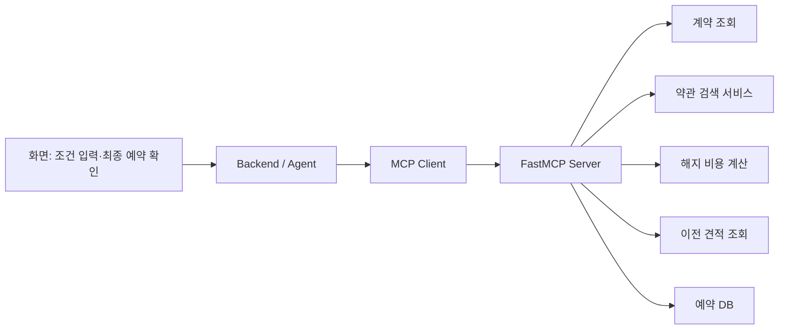

# MCP 담당자를 위한 구현 참고자료

조사일: **2026-10-12**. 대상: LG Move Care 기획안의 MCP 도구 5개. 공식 문서에서 확인한 내용과 이 프로젝트에 적용하는 **설계 제안**을 구분했다. 이 폴더는 조사·설계 자료이며, MCP 서버 구현 완료나 테스트 통과를 의미하지 않는다.

## 어디부터 볼까?

고객 계약·이전 견적·기사 일정·예약 파일 자체를 먼저 이해하려면 [업무 데이터 설명서](BUSINESS_DATA_GUIDE.md)를 읽는다. 실제 파일의 예시와 연결 키, 기사 일정의 중복 후보 문제를 함께 설명했다.

1. 이 문서에서 역할과 읽을 자료를 확인한다.
2. [도구 5개 입출력 설계](TOOL_CONTRACTS.md)를 Agent·RAG 담당자와 합의한다.
3. [서버·클라이언트 연동](INTEGRATION.md) 순서로 조회 도구부터 연결한다.
4. [예약·동시성·검증 시나리오](BOOKING_AND_TESTING.md)에 따라 쓰기 도구를 구현한다.
5. [출처 목록](sources.json)에서 확인일·적용 이유·버전 주의점을 찾는다.

## MCP 담당 범위 제안

MCP 담당자는 **도구 인터페이스, 입력 검증, 업무 함수 호출, 구조화 응답, 오류 처리, 예약의 원자성**을 맡는다. LLM은 결과 설명을 도울 수 있지만 금액 계산·권한 판정·예약 중복 방지는 서버 코드가 수행하도록 제안한다. RAG 저장소 구축과 화면 구현은 팀 역할에 따라 별도이며, MCP에는 검색 결과와 최종 확인 상태를 넘기는 인터페이스가 필요하다.

MCP는 내부 계약·예약 API를 자동으로 제공하지 않는다. 현재 확보한 JSON과 SQLite로 데모 어댑터를 만들고, 실제 시스템을 확보하면 데이터 접근 계층을 교체하는 구조가 적합하다. 이것은 이번 기획에 대한 적용 제안이다.

## 우선순위별 공식 자료

| 우선순위 | 자료 | 읽을 부분 | 우리 프로젝트에 쓰는 곳 |
| --- | --- | --- | --- |
| 1 | [FastMCP Tools](https://gofastmcp.com/servers/tools) | 타입·입출력 스키마·구조화 출력·오류 | 5개 도구 등록 및 반환 형식 |
| 1 | [FastMCP Calling Tools](https://gofastmcp.com/clients/tools) | `list_tools`, `call_tool`, 구조화 결과 | Agent 담당자와 연동 계약 |
| 1 | [FastMCP Testing](https://gofastmcp.com/servers/testing) | 메모리 내 Client와 pytest | LLM 없이 MCP 호출 검증 |
| 1 | [MCP Tools 규격](https://modelcontextprotocol.io/specification/2026-07-28/server/tools) | 입력·출력 스키마, 도구 오류 | 프로토콜과 업무 응답의 구분 |
| 2 | [FastMCP 실행·Transport](https://gofastmcp.com/deployment/running-server) | stdio·Streamable HTTP | 로컬 개발과 팀 서버 연결 |
| 2 | [MCP Inspector](https://modelcontextprotocol.io/docs/2026-07-28/tools/inspector) | 도구 목록·입력·호출 결과 | 수동 점검 및 데모 준비 |
| 2 | [SQLite Transaction](https://www.sqlite.org/lang_transaction.html) | `BEGIN IMMEDIATE`, `SQLITE_BUSY` | 예약 생성과 슬롯 차감을 한 단위로 처리 |
| 2 | [SQLite Partial Index](https://www.sqlite.org/partialindex.html) | UNIQUE 부분 인덱스 | 활성 예약의 업무상 중복 방지 |
| 2 | [SQLite ON CONFLICT](https://www.sqlite.org/lang_conflict.html) | 충돌 처리와 REPLACE 동작 | 재시도 시 기존 예약을 덮어쓰지 않는 설계 |
| 3 | [FastMCP Authentication](https://gofastmcp.com/servers/auth/authentication) | HTTP 인증과 접근 통제 | 외부에서 접근 가능한 서버로 확장할 때 |
| 3 | [MCP Tool Annotations 설명](https://blog.modelcontextprotocol.io/posts/2026-03-16-tool-annotations/) | 도구의 동작 힌트와 한계 | 조회 도구·예약 도구의 특성 표현 |
| 선택 | [LangChain MCP 연동](https://docs.langchain.com/oss/python/langchain/mcp) | `MCPAdapter`와 요구 패키지 | 팀이 LangChain의 자동 도구 호출을 선택할 때 |

## 버전을 먼저 맞추기

공식 FastMCP 웹 문서는 `main` 기준이어서 미출시 기능이 섞일 수 있다. 도입 버전과 설치 버전을 확인하고 프로젝트 의존성을 고정한다. [공식 안내](https://gofastmcp.com/getting-started/welcome), [설치·버전 확인](https://gofastmcp.com/getting-started/installation).

같은 로컬 작업 폴더의 별도 프로젝트 `cx-agent/Backend/requirements.txt`에는 `fastmcp==4.0.11`, `langchain-core==1.6.7`, `langchain-openai==1.6.7`이 선언되어 있었다. **이는 TV 상담 프로젝트의 참고 코드이며, Move Care의 확정 의존성이나 설치 완료 증거가 아니다.** 해당 파일과 MCP server/client를 읽기만 했으며 수정하지 않았다.

조사일의 LangChain 공식 문서는 `langchain.mcp.MCPAdapter`를 안내하며 `langchain[mcp]>=1.4.0`과 beta 상태를 명시한다. `langchain-core`만 설치한 환경에서 이 import가 되는 것은 아니다. 기존 `MultiServerMCPClient` 예제를 사용할 때도 팀의 실제 패키지·버전에 맞는 문서를 확인한다. 현재 프로젝트에 자동 업그레이드를 적용하지 않았다. [LangChain 공식 문서](https://docs.langchain.com/oss/python/langchain/mcp).

## 기존 데이터와 도구 연결

| 도구 | 바로 사용할 파일 | 구현 전에 보완할 정보 |
| --- | --- | --- |
| `get_customer_contract` | `mock/contracts.json`, `mock/customers.json` | 인증 사용자와 고객 ID 매핑, 조회 동의 |
| `search_contract_terms` | `processed/rag_rules.jsonl`, `mock/terms.json` | 실제 계약 약관 원문·적용일·버전 |
| `calculate_termination_cost` | `mock/contracts.json`, `mock/evaluation_cases.json` | 일할 계산·정확한 경계일·반올림 정책 |
| `get_relocation_quote` | `mock/quotes.json`, `processed/installation_reference.json` | 실제 주소별 견적·모델·현장 판정 |
| `manage_relocation_booking` | `mock/slots.json`, `mock/lg_move_care.sqlite` | 예약 의도·승인 토큰·중복 키·2개 작업 슬롯 저장 구조 |

위 경로는 저장소 루트 기준이다. 데이터 컬럼은 [데이터 설명서](../DATA_DICTIONARY.md)에 있다. 지금 SQLite는 초기 시드이며 예약 업무 완성본이 아니다. 특히 현재 `bookings`의 슬롯 FK는 하나이므로 철거·재설치 두 작업을 묶으려면 구조 확장이 필요하다.

## 이번에 저장한 자료의 성격

- 공식 원문을 확인하고 한국어로 요약한 학습 자료와 링크를 저장했다. 외부 문서 전체 복제본은 포함하지 않았다.
- 입력·출력 예시, 오류 코드, DB 확장안, 테스트 항목은 **팀 합의 전 제안**이다. 공식 MCP 규격이나 LG 내부 API 명세로 읽지 않는다.
- 코드 예시는 설명용이며 이번 작업에서 서버 실행·LLM 평가·실제 예약을 수행하지 않았다.
